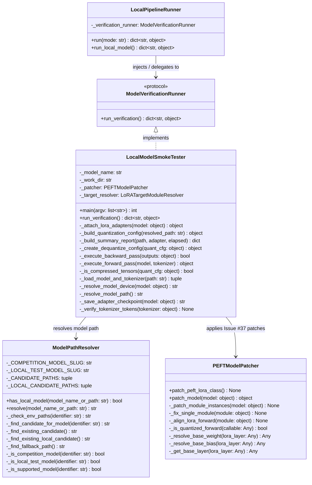

# Detailed Design 06 — Local Model Verification & Smoke Testing (`gemma-4-e2b-it-qat-w4a16-ct`)

---

## 1. Overview & Architectural Purpose

The Local Model Verification harness establishes an isolated, fast-feedback execution environment utilizing Google's `gemma-4-e2b-it-qat-w4a16-ct` (~2B active parameter QAT W4A16 Mixture of Experts model). Its primary purpose is validating the end-to-end post-training mechanics, Hugging Face / TRL library compatibility, quantization lifecycle hooks, and PEFT LoRA adapter attachment directly on a developer workstation.

This component eliminates the 15–25 minute latency of pushing to remote Kaggle GPU clusters and specifically prevents recurring initialization defects such as **GitHub Issue #37** (`AttributeError: 'Linear' object has no attribute 'weight'`).

```mermaid
flowchart TB
    subgraph DISCOVERY["Model Path Discovery & Gating"]
        CONST["constants.py\n(LOCAL_TEST_MODEL_NAME,\nLOCAL_TEST_MODEL_SLUG)"]
        MPR["ModelPathResolver\n(has_local_model,\nresolve)"]
        ENV["Env Overrides\n(LOCAL_MODEL_PATH,\nGEMMA_E2B_MODEL_PATH)"]
    end

    subgraph ORCHESTRATION["Runner Decoupling & Invocation"]
        MVR["<<protocol>>\nModelVerificationRunner\n(+run_verification())"]
        LPR["LocalPipelineRunner\n(--mode local_model)"]
        LMST["LocalModelSmokeTester\n(implements ModelVerificationRunner)"]
    end

    subgraph LIFECYCLE["7-Stage Model Verification Workflow"]
        S1["Stage 1: Resolve Model Path"]
        S2["Stage 2: Build Dequantize Config & Load Model/Tokenizer"]
        S3["Stage 3: Validate Gemma 4 Delimiter Tokens"]
        S4["Stage 4: Apply LoRA & Issue #37 PEFT Patches"]
        S5["Stage 5: Single-Step Forward Pass (self.weight validation)"]
        S6["Stage 6: Single-Step Backward Pass (gradient validation)"]
        S7["Stage 7: Save Adapter Weights & Checkpoint Artifacts"]
    end

    CONST --> MPR
    ENV --> MPR
    MPR --> LMST
    MVR <|.. LMST
    LPR --> MVR
    LMST --> S1 --> S2 --> S3 --> S4 --> S5 --> S6 --> S7
```

---

## 2. Architectural Invariant: MoE Scope Guardrail

> **CRITICAL ARCHITECTURAL INVARIANT**:
> `gemma-4-e2b-it-qat-w4a16-ct` is a **Mixture of Experts (MoE)** architecture (~2B effective parameters), whereas the competition production model `gemma-4-31b-it-qat-w4a16-ct` is a **dense** transformer.

Because the routing, gating, and feedforward expert layers differ fundamentally between the two architectures:
1. **Syntax & Wiring Only**: The local test setup is used **exclusively** to verify syntax, argument validity, library interoperability, and quantization lifecycle hooks.
2. **No Production MoE Specialization**: We do **NOT** modify production LoRA target resolver logic, curriculum schedulers, or reward modeling to tailor to MoE expert modules.
3. **Restricted Target Modules**: Local smoke testing is explicitly constrained to shared attention projection layers (`q_proj`, `v_proj`) common across both models.

---

## 3. Class Architecture & Design Contracts



---

## 4. The 7 Verification Workflow Stages

The `LocalModelSmokeTester.run_verification()` workflow executes sequentially:

### Stage 1: Model Path Resolution
Resolves the model identifier through `ModelPathResolver.resolve()`:
1. Literal existing path on filesystem (`os.path.exists`).
2. Environment variables: `LOCAL_MODEL_PATH`, `GEMMA_E2B_MODEL_PATH`, `MODEL_PATH`.
3. Local candidate search paths:
   - `./models/gemma-4-e2b-it-qat-w4a16-ct`
   - `~/.cache/huggingface/hub/models--google--gemma-4-e2b-it-qat-w4a16-ct`
4. Hugging Face repository slug fallback: `google/gemma-4-e2b-it-qat-w4a16-ct`.

### Stage 2: Model & Tokenizer Loading with Quantization Detection
- Reads model configuration via `AutoConfig.from_pretrained()`.
- Detects `quant_method == "compressed-tensors"`.
- If compressed-tensors are present, builds `CompressedTensorsConfig(dequantize=True)` to permit floating-point adapter gradient training while leveraging packed weights.
- Loads `AutoModelForCausalLM` using dynamic device placement (`cuda` with `bfloat16` if GPU is available; `cpu` with `float32` fallback).

### Stage 3: Special Tokens Verification
Validates that the tokenizer vocabulary contains all 14 mandatory Gemma 4 delimiting tokens:
```python
(
    "<|turn>", "<turn|>",
    "<|tool>", "<tool|>",
    "<|tool_call>", "<tool_call|>",
    "<|tool_response>", "<tool_response|>",
    "<|think|>",
    "<|channel>", "<channel|>",
    "<|image|>", "<|audio|>", "<|video|>",
)
```
If any token is absent, a `ValueError` is raised immediately.

### Stage 4: PEFT LoRA Adaptation & Hook Alignment (Issue #37 Prevention)
- Invokes `PEFTModelPatcher.patch_peft_lora_class()` to attach delegating properties for `.weight` and `.bias` to `peft.tuners.lora.layer.Linear`.
- Resolves target modules using `LoRATargetModuleResolver.resolve()`.
- Wraps model via `get_peft_model(model, lora_config)`.
- Invokes `PEFTModelPatcher.patch_model()` to realign any Accelerate / `_old_forward` hooks that inadvertently target `quantized_forward` in outer layer contexts.

### Stage 5: Single-Step Forward Pass
- Constructs minimal dummy tokens (`[1, 16]`) using `pad_token_id`.
- Safely discovers device string from model parameters via `_resolve_model_device()`.
- Dispatches model forward pass: `outputs = model(input_ids, attention_mask)`.
- Verifies that `quantized_forward` accesses `self.weight` via delegation without raising `AttributeError`.

### Stage 6: Single-Step Backward Pass
- Obtains or computes scalar loss (`outputs.loss` or `outputs.logits.sum()`).
- Executes `loss.backward()`.
- Verifies that gradients flow back into trainable LoRA projection parameters.

### Stage 7: Adapter Checkpoint Persistence
- Invokes `model.save_pretrained(adapter_dir)`.
- Verifies existence of `adapter_model.safetensors` and `adapter_config.json`.
- Compiles and returns structured execution report:
```json
{
  "status": "success",
  "model_name": "google/gemma-4-e2b-it-qat-w4a16-ct",
  "resolved_path": "models/gemma-4-e2b-it-qat-w4a16-ct",
  "forward_passed": true,
  "backward_passed": true,
  "adapter_saved": true,
  "elapsed_seconds": 3.42
}
```

---

## 5. Issue #37 Mechanics & Guardrail Architecture

### Root Cause
During SFT training under `compressed-tensors`, linear layers have their forward callable replaced with `quantized_forward`. When PEFT wraps a linear module:
1. `peft.tuners.lora.layer.Linear` wraps the underlying layer as `self.base_layer`.
2. Standard PEFT `Linear` instances do not expose `.weight` directly.
3. Accelerate hooks or monkey-patched references that execute `quantized_forward` within the PEFT `Linear` context evaluate:
   ```python
   weight = self.weight  # onload once
   ```
4. This raised `AttributeError: 'Linear' object has no attribute 'weight'`.

### Two-Tier Resolution Architecture
1. **Dynamic Class-Level Property Delegation**:
   `PEFTModelPatcher.patch_peft_lora_class()` attaches property descriptors to `peft.tuners.lora.layer.Linear`:
   ```python
   def _resolve_base_weight(self, lora_layer: Any) -> Any:
       base = self._get_base_layer(lora_layer)
       return getattr(base, "weight", None)
   ```
2. **Hook Target Alignment**:
   `PEFTModelPatcher._align_lora_forward()` scans all named modules and redirects any `_old_forward` hook pointing to `quantized_forward` back to the class forward implementation.

---

## 6. Testing Strategy & Isolation

| Test Category | Target File | Verification Scope | Physical Weights Required? |
|---|---|---|---|
| **Unit Test** | `tests/unit/utils/test_model_path_resolver.py` | Resolution priorities, fallback, `has_local_model`, env overrides. | **NO** (mocks `os.path.exists`) |
| **Unit Test** | `tests/unit/training/test_peft_model_patcher.py` | Issue #37 regression: `.weight` and `.bias` resolution on PEFT layers. | **NO** (mock linear module) |
| **Unit Test** | `tests/unit/training/test_local_model_smoke_tester.py` | Complete 7-stage workflow, special tokens validation, CLI parser, loader failure modes. | **NO** (mocks HF & PEFT) |
| **Unit Test** | `tests/unit/training/test_local_pipeline_runner.py` | Pipeline runner mode dispatching to `ModelVerificationRunner`. | **NO** (injected test double) |
| **Integration Test** | `tests/integration/test_local_model_smoke.py` | Full end-to-end forward/backward execution against physical model weights. | **CONDITIONAL** (skipped if weights absent) |

---

## 7. Developer Usage & CLI Workflows

### Manual CLI Verification
Run directly inside the activated Kaggle environment:
```bash
source ~/python_envs/p312_kaggle/bin/activate

# Execute via LocalPipelineRunner
python -m src.training.local_pipeline_runner --mode local_model

# Or run standalone smoke tester
python -m src.training.local_model_smoke_tester --model-name google/gemma-4-e2b-it-qat-w4a16-ct
```

### Path Overrides
For customized local directory mounts:
```bash
LOCAL_MODEL_PATH=/opt/models/gemma-4-e2b-it-qat-w4a16-ct python -m src.training.local_pipeline_runner --mode local_model
```

### Running Real Integration Tests
```bash
source ~/python_envs/p312_kaggle/bin/activate
pytest tests/integration/test_local_model_smoke.py -v -s
```
If weights are not found on disk, the test outputs:
```text
SKIPPED [1] tests/integration/test_local_model_smoke.py: Local Gemma 4 E2B weights not present on disk
```
If weights are present, it loads the model and runs full tensor operations.
