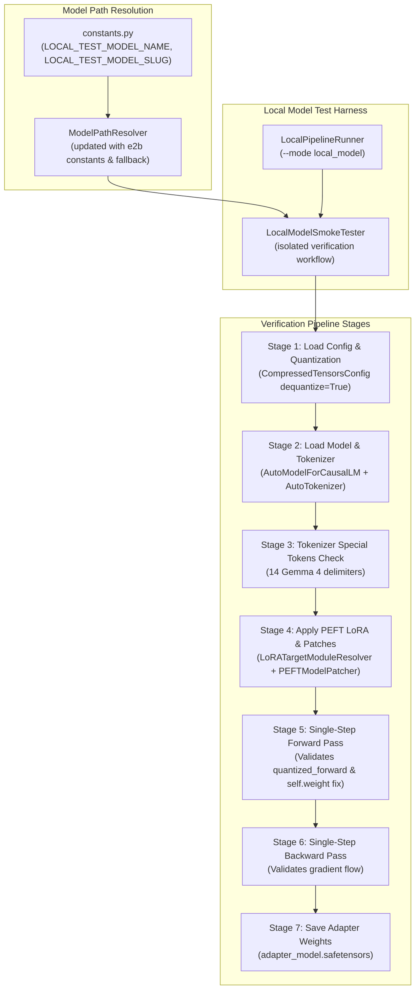
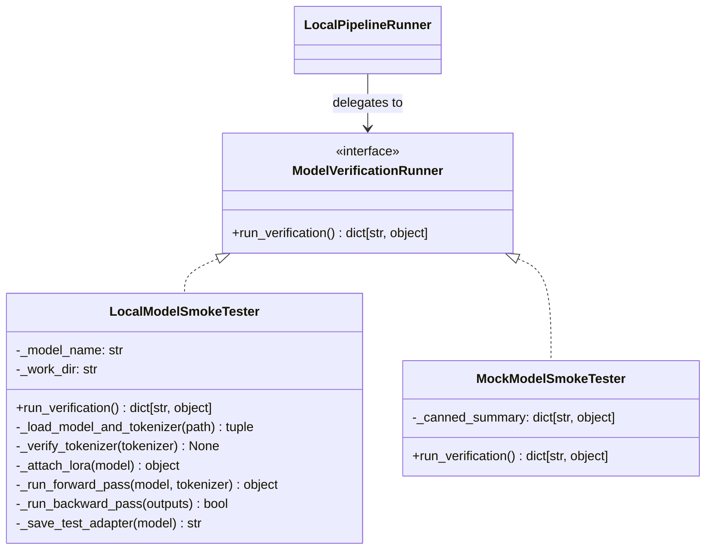

# Enhancement Design 07 — Local Model Support (`gemma-4-e2b-it-qat-w4a16-ct`)

---

## 1. Problem Statement & Motivation

During post-training pipeline development for the Kaggle Gemma 4 Developer Agent competition, recurring runtime defects have continued to surface only after pushing datasets and executing remote Kaggle GPU notebooks. Most recently, **GitHub Issue #37** documented a critical runtime crash during SFT training:

```text
AttributeError: 'Linear' object has no attribute 'weight'
  at /usr/local/lib/python3.12/dist-packages/compressed_tensors/quantization/lifecycle/forward.py:272 in quantized_forward
  weight = self.weight  # onload once
```

### 1.1 The Feedback Loop Bottleneck

The current debugging cycle suffers from severe latency:
1. Package source code and configurations into `kaggle_staging/`.
2. Push dataset version via Kaggle API (`kaggle datasets version -p kaggle_staging/`).
3. Wait for Kaggle dataset ingestion and cluster scheduling.
4. Start a remote 4x NVIDIA L4 GPU Kaggle notebook and queue for execution.
5. Encounter a runtime crash (such as Issue #37) after 15–25 minutes of overhead.
6. Inspect remote stack traces, hypothesize fixes, and repeat the cycle.

### 1.2 Why the Previous Surrogate Model Was Insufficient

In Enhancement 06, `SurrogateModelFactory` was introduced to run local smoke tests using a micro causal language model (`LlamaForCausalLM`). While this confirmed basic TRL trainer wiring and argument parsing, it failed to catch Issue #37 because:
- **No Compressed-Tensors Quantization**: The surrogate model was an unquantized float32 standard Llama model. It did not exercise `CompressedTensorsConfig`, QAT W4A16 weight loading, or `quantized_forward` lifecycle hooks.
- **No Gemma 4 Model Architecture**: It did not exercise `Gemma4ForCausalLM` or its internal modules (`Gemma4ClippableLinear`, attention projection layers, or native tokenizer wrappers).
- **Masked PEFT / Quantization Incompatibilities**: The failure in Issue #37 occurs specifically when PEFT LoRA adapters wrap layers that are simultaneously subject to `compressed_tensors` forward hooks or Accelerate dispatch hooks.

---

## 2. Target Model Selection & Architectural Distinction

To achieve high-fidelity local validation without requiring multi-GPU clusters, we introduce a local model test setup using Google's smaller quantized Gemma 4 model:

> **Local Model Identifier**: `google/gemma-4-e2b-it-qat-w4a16-ct` (or local slug `gemma-4-e2b-it-qat-w4a16-ct`)

### 2.1 Mixture of Experts (MoE) vs Dense Architecture (CRITICAL INVARIANT)

There is a fundamental architectural divergence between the local test model and the competition production model:

| Characteristic | Local Test Model (`e2b-it-qat-w4a16-ct`) | Production Competition Model (`31b-it-qat-w4a16-ct`) |
|---|---|---|
| **Architecture** | Mixture of Experts (MoE) | Dense Transformer |
| **Parameter Scale** | ~2B effective / active parameters | 31B dense parameters |
| **Quantization Format** | QAT W4A16 (`compressed-tensors`) | QAT W4A16 (`compressed-tensors`) |
| **Feedforward Layer** | MoE Experts & Router gating layers | Dense `gate_proj`, `up_proj`, `down_proj` |
| **VRAM Footprint** | ~1.5 GB – 2.5 GB (fits CPU or laptop GPU) | ~18 GB – 24 GB (requires Kaggle 4x L4 GPUs) |
| **Local Viability** | Fully runnable on developer workstation | Out-Of-Memory (OOM) on local workstation |

### 2.2 Scope Guardrail: Syntax & Basic Wiring Only

Because `gemma-4-e2b-it-qat-w4a16-ct` is a Mixture of Experts model:
1. **Layer Hierarchy Divergence**: The details of specific feedforward layers, routing mechanisms, and expert modules differ fundamentally from the 31B dense model.
2. **Restricted Test Scope**: The local model test setup is **STRICTLY for testing syntax, library compatibility, lifecycle hooks, and basic pipeline wiring**.
3. **No MoE Specialization in Production**: We do **NOT** modify production LoRA target resolver logic or training configurations to specialize for MoE routing or expert layers.
4. **Safe Shared Target Modules**: For local smoke tests, target modules are restricted to common attention projection layers present across both architectures (e.g., `q_proj`, `v_proj`).

---

## 3. Root Cause Analysis: GitHub Issue #37

### 3.1 Failure Trace Analysis

In Issue #37, the following sequence led to failure:
1. `sft_pipeline.run(sft_config, dataset)` is invoked on Kaggle.
2. Model is loaded with `CompressedTensorsConfig(dequantize=True)`.
3. `_apply_lora()` resolves targets (`q_proj.linear`, etc.) and calls `get_peft_model()`.
4. `PEFTModelPatcher` patches LoRA `Linear` classes and module hooks.
5. When `trainer.train()` starts the first forward pass:
   ```text
   transformers/models/gemma4/modeling_gemma4.py:1249 in forward
     query_states = self.q_proj(hidden_states).view(hidden_shape)
   accelerate/hooks.py:192 in new_forward
     output = module._old_forward(*args, **kwargs)
   compressed_tensors/quantization/lifecycle/forward.py:272 in quantized_forward
     weight = self.weight  # onload once
   torch/nn/modules/module.py:1965 in __getattr__
     raise AttributeError(f"'{type(self).__name__}' object has no attribute '{name}'")
   AttributeError: 'Linear' object has no attribute 'weight'
   ```

### 3.2 Mechanism of Failure

1. `compressed_tensors` replaces or hooks the `forward` method of quantized linear layers with `quantized_forward`.
2. When PEFT wraps the layer with `peft.tuners.lora.layer.Linear`, the PEFT layer wraps the base layer (`base_layer`).
3. If Accelerate's `_old_forward` hook or `quantized_forward` executes in the context of the PEFT `Linear` wrapper instead of the inner base layer, it attempts to access `self.weight`.
4. In standard PEFT, `peft.tuners.lora.layer.Linear` does not hold a direct `.weight` attribute (weights reside on `self.base_layer.weight` or `self.base_layer.linear.weight`).
5. Without a local quantized model, testing this interaction required pushing to Kaggle, waiting 20 minutes, and failing on step 1.

With `gemma-4-e2b-it-qat-w4a16-ct`, this exact lifecycle (`compressed_tensors` + PEFT LoRA + Accelerate hooks) can be reproduced and verified locally in under 15 seconds.

---

## 4. Architecture & Component Design



### 4.1 Component Responsibilities

#### 1. Constants Update (`src/utils/constants.py`)
Add explicit identifiers for the local test model:
- `LOCAL_TEST_MODEL_NAME: str = "google/gemma-4-e2b-it-qat-w4a16-ct"`
- `LOCAL_TEST_MODEL_SLUG: str = "gemma-4-e2b-it-qat-w4a16-ct"`

#### 2. `ModelPathResolver` Updates (`src/utils/model_path_resolver.py`)
Enhance `ModelPathResolver` to resolve the local test model with the following priority:
1. Explicit local path if it exists on disk (`os.path.exists(path)`).
2. Environment variables: `LOCAL_MODEL_PATH`, `GEMMA_E2B_MODEL_PATH`, `GEMMA_MODEL_PATH`, `MODEL_PATH`.
3. Standard local search locations:
   - `./models/gemma-4-e2b-it-qat-w4a16-ct`
   - `~/.cache/huggingface/hub/models--google--gemma-4-e2b-it-qat-w4a16-ct/snapshots/...`
4. Fallback to repository identifier `google/gemma-4-e2b-it-qat-w4a16-ct` for Hugging Face Hub resolution.

#### 3. `LocalModelSmokeTester` (`src/training/local_model_smoke_tester.py`)
A dedicated, single-responsibility class that executes the 7 verification stages:
- **`run_verification(self) -> dict[str, object]`**: Public entry point returning a status report.
- **Stage 1 & 2 (`_load_model_and_tokenizer`)**:
  - Resolves path via `ModelPathResolver`.
  - Configures `CompressedTensorsConfig(dequantize=True)` via `SFTTrainerPipeline._build_quantization_config` logic.
  - Loads model with `device_map="auto"` (or `"cpu"` fallback) and `torch_dtype=torch.bfloat16`.
- **Stage 3 (`_verify_tokenizer`)**:
  - Validates that all 14 Gemma 4 special tokens are present in the tokenizer vocabulary.
- **Stage 4 (`_attach_lora`)**:
  - Uses `LoRATargetModuleResolver` to resolve target layers (`q_proj`, `v_proj`).
  - Calls `PEFTModelPatcher().patch_peft_lora_class()`.
  - Attaches LoRA adapter with `get_peft_model()`.
  - Calls `PEFTModelPatcher().patch_model()`.
- **Stage 5 (`_run_forward_pass`)**:
  - Constructs minimal dummy input tokens (`input_ids` shape `[1, 16]`).
  - Executes model forward pass: `outputs = model(input_ids=input_ids)`.
  - **Directly verifies that Issue #37 does not trigger**.
- **Stage 6 (`_run_backward_pass`)**:
  - Computes dummy loss: `loss = outputs.logits.sum()`.
  - Executes `loss.backward()`.
  - Verifies that LoRA adapter gradients are populated (`grad is not None`).
- **Stage 7 (`_save_test_adapter`)**:
  - Persists adapter weights using `save_pretrained()` to a test output directory.
  - Verifies existence of `adapter_model.safetensors` and `adapter_config.json`.

#### 4. `LocalPipelineRunner` Integration (`src/training/local_pipeline_runner.py`)
Add support for the new mode:
- Mode identifier: `_MODE_LOCAL_MODEL: ClassVar[str] = "local_model"`.
- CLI argument `--mode local_model`.
- Method `run_local_model(self) -> dict[str, object]` delegating directly to `LocalModelSmokeTester`.

### 4.2 Developer Execution Workflow: Running the Real Local Model

Because unit tests use test doubles and do not load physical weights, the developer executes verification against the real quantized model via two explicit mechanisms:

#### Mechanism 1: Direct CLI Command (Manual / On-Demand Verification)
The developer runs the verification directly from the terminal inside the virtual environment:
```bash
# 1. Activate Kaggle-matched environment
source ~/python_envs/p312_kaggle/bin/activate

# 2. Run local model verification (auto-resolves from cache or local path)
python -m src.training.local_pipeline_runner --mode local_model
```
Or with custom local path override:
```bash
LOCAL_MODEL_PATH=/path/to/gemma-4-e2b-it-qat-w4a16-ct python -m src.training.local_pipeline_runner --mode local_model
```
**Output**: Emits structured JSON summary verifying that all 7 stages completed:
```json
{
  "status": "success",
  "model_name": "google/gemma-4-e2b-it-qat-w4a16-ct",
  "resolved_path": "/home/user/.cache/huggingface/hub/models--google--gemma-4-e2b-it-qat-w4a16-ct",
  "forward_passed": true,
  "backward_passed": true,
  "adapter_saved": true,
  "elapsed_seconds": 12.4
}
```

#### Mechanism 2: Real Integration Test via Pytest
A dedicated integration test in `tests/integration/test_local_model_smoke.py`:
```bash
source ~/python_envs/p312_kaggle/bin/activate
pytest tests/integration/test_local_model_smoke.py -v -s
```
- **How it runs**: Unlike unit tests, this test executes the **real** `LocalModelSmokeTester` without mocks.
- **Conditional Skip Guard**: If weights are not downloaded locally, it is gracefully skipped (`pytest.skip("Local Gemma 4 E2B weights not present on disk")`).
- **When weights exist**: It runs end-to-end, loading the real quantized weights, attaching LoRA adapters, and verifying that the forward pass does not raise `AttributeError: 'Linear' object has no attribute 'weight'`.

---

## 5. Repository & Git Hygiene: Zero Model Weights in Version Control

A critical operational requirement is that **no binary model weights or large model files may ever be checked into Git or pushed to GitHub**:

1. **Strict `.gitignore` Invariant**:
   - Large model weight formats and directory paths must be explicitly ignored:
     - `models/`
     - `kaggle_working/`
     - `*.safetensors`
     - `*.bin`
     - `*.pt`
     - `*.pth`
     - `*.onnx`
   - Test adapters generated during smoke runs must be isolated to temporary directories (`kaggle_working/` or `/tmp/`) that are ignored.

2. **Decoupling Unit Tests from Physical Model Weights**:
   - Unit tests executed by `pytest` in local CI or GitHub Actions **MUST NOT** require, download, or depend upon physical model weights.
   - CI runners possess limited disk and network budgets; attempting to download or verify multi-gigabyte models in unit test suites causes CI timeouts and non-deterministic failures.
   - Unit tests validate the orchestration logic, stage progression, error handling, and parameter mappings using an **extracted abstraction and in-memory test doubles**.

---

## 6. Extracted Verification Abstraction

To ensure unit tests remain 100% isolated from physical weights while testing the complete lifecycle, we extract an explicit abstraction:



### 6.1 `ModelVerificationRunner` Protocol (`src/training/model_verification_runner.py`)
Defines the abstract interface for model verification:
```python
from typing import Protocol, runtime_checkable

@runtime_checkable
class ModelVerificationRunner(Protocol):
    """Protocol defining the contract for model verification smoke testers."""

    def run_verification(self) -> dict[str, object]:
        """Execute verification workflow and return status summary."""
        ...
```

### 6.2 Unit Test vs Integration Test Boundary

- **Unit Tests (`tests/unit/training/`)**:
  - Test `LocalModelSmokeTester` methods using mocked Hugging Face `AutoModelForCausalLM`, `AutoTokenizer`, and `PEFT` modules via `unittest.mock`.
  - Test `LocalPipelineRunner` using mock implementations of `ModelVerificationRunner` (e.g. `MockModelSmokeTester`).
  - Zero disk I/O to large model files, zero network downloads, instantaneous execution (< 100ms per test).
- **Integration Tests (`tests/integration/test_local_model_smoke.py`)**:
  - Contains the real end-to-end execution against `gemma-4-e2b-it-qat-w4a16-ct`.
  - Guarded by `@pytest.mark.skipif(not ModelPathResolver.has_local_model(...), reason="Local Gemma 4 weights not present")`.
  - Only runs when developer explicitly runs integration tests with weights downloaded locally.

---

## 7. Coding Standards & Architectural Guardrails

The implementation strictly satisfies all requirements of `documentation/prompts/coding_standards.md`:

1. **SOLID Principles**:
   - **Single Responsibility**: `LocalModelSmokeTester` has one responsibility: validating the local model training mechanics.
   - **Open/Closed**: Open to testing future model variants via model path injection without altering core logic.
   - **Liskov Substitution**: `LocalModelSmokeTester` implements `ModelVerificationRunner` substitutable anywhere in `LocalPipelineRunner`.
   - **Interface Segregation**: Clean, single-method interface in `ModelVerificationRunner`.
   - **Dependency Inversion**: `LocalPipelineRunner` accepts `ModelVerificationRunner` interface rather than hardcoding a concrete class.
2. **Strict OOP**:
   - Single class per file.
   - No free-standing functions or module-level executable code.
   - CLI invocation via class-level `main()` method under `if __name__ == "__main__":`.
3. **Member Ordering**:
   - Class-level constants (`_` prefix)
   - `__init__()`
   - Public methods (`run_verification`)
   - Protected methods (`_`)
   - Private methods (`__`)
4. **Method Length**:
   - Body strictly ≤ 20 logical lines. Helper methods extracted for each distinct stage.
5. **File Length**:
   - Total file lines strictly ≤ 500 lines.
6. **No Magic Strings or Numbers**:
   - All string literals, configuration keys, and numeric constants defined as class-level constants.
7. **Virtual Environment**:
   - Executed within `source ~/python_envs/p312_kaggle/bin/activate`.

---

## 8. Verification & Test Strategy

| Test Type | Test Location | Purpose | Weights Required? |
|---|---|---|---|
| **Unit Test** | `tests/unit/utils/test_model_path_resolver.py` | Verify `ModelPathResolver` resolution of `gemma-4-e2b-it-qat-w4a16-ct` via env vars and fallback. | **NO** (mocks filesystem) |
| **Unit Test** | `tests/unit/training/test_local_model_smoke_tester.py` | Verify `LocalModelSmokeTester` stage execution with mocked model/tokenizer. | **NO** (mocks HF/PEFT) |
| **Unit Test** | `tests/unit/training/test_local_pipeline_runner.py` | Verify `LocalPipelineRunner` dispatches `--mode local_model` correctly via `ModelVerificationRunner`. | **NO** (mocks runner) |
| **Integration Test** | `tests/integration/test_local_model_smoke.py` | End-to-end execution with real weights when available locally; gracefully skipped if weights absent. | **OPTIONAL** (skipped if absent) |

---

## 9. Local CI Verification (Mandatory Gate)

Before completion, the full CI suite must pass cleanly in `~/python_envs/p312_kaggle`:
1. `ruff check ./src ./tests` (0 lint errors).
2. `mypy ./src` (0 type errors, strict mode).
3. `pytest` (0 test failures, ≥ 90% branch and line coverage).
